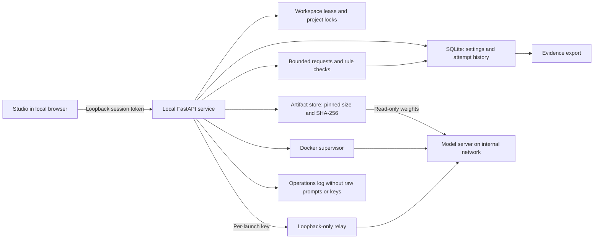

# Furnace: technical interview guide

## The story

Furnace turns a supported research model into an isolated local service with evaluations,
logs and crash recovery. The researcher keeps control over downloads and execution.
Studio is the product entry point. Guard, Scan, Forge, bench and kernel work are earlier
engineering projects, available for a separate discussion.

The current scope is a single-user local application. A hosted subscription is a proposal.
An independent user deployment is still planned; do not describe it as completed.

## Architecture

The model container is non-root, resource-limited and has a read-only root filesystem.
The relay is the only published endpoint. An internal network restricts external routes;
it does not fully isolate host services. Docker administrators remain trusted and can
inspect container environment credentials. This is not a multi-tenant security boundary.

Read the implementation in [Studio](../apps/api/furnace_api/studio.py),
[supervision](../packages/furnace/src/furnace/runtime/serving.py) and
[adapter contracts](../packages/furnace/src/furnace/runtime/adapter.py).

## Five decisions and their trade-offs

1. **Start with pinned recipes.** Engine images use digests; reviewed weights use revision,
   size and SHA-256. That makes a run explainable and rejects altered assets. It limits
   supported models. The advanced Python adapter needs an author-supplied contract;
   custom weights are not content-verified like recipe weights.
2. **Keep execution explicit.** Downloads, starts and retries require an action. Docker
   containers can survive a crashed Studio, so reopening reconciles owned resources and
   requires explicit restart. This avoids surprise execution but asks the user to recover.
3. **Bind evidence to configuration.** Project/configuration identities fence results and
   history. A completed record from another configuration cannot validate the current one.
   Hashes establish which declared inputs were used, not the truth of an external server's
   model identity. See [endpoint evidence](../apps/api/furnace_api/studio_model_evidence.py).
4. **Use local ownership before distributed coordination.** One lease protects a workspace;
   project locks serialize conflicting operations. SQLite keeps the first deployment small.
   It is not a substitute for a multi-user control plane, scheduler or distributed lease.
5. **Prefer explainable checks to a broad quality score.** Exact, numeric and other rules
   are inspectable. Unscored, incomplete, failed and missing cases stay distinct. Rules
   can still be wrong, and output agreement is not semantic quality. HTTP round trips are
   not TTFT or proof of a performance improvement.

## Three verified bug stories

### A stale read destroyed a completed evaluation

Shutdown recovery read a running attempt before waiting for its project lock. The batch
finished while recovery waited; recovery then wrote its stale copy back as interrupted.
The fix reads again inside the lock. The regression holds a real authored HTTP response,
starts recovery concurrently, then releases the batch and checks the saved results and
history against the response returned by the batch.

Evidence: commit `2d1d297`; [recover](../apps/api/furnace_api/studio_model.py) and
`test_shutdown_recovery_never_rewrites_a_batch_that_ended_while_it_waited` in
[the endpoint tests](../apps/api/tests/test_studio_model.py).
Lesson: a lock does not make data read before acquiring it fresh.

### A useful HTTP error became a TCP reset

The Python serving host replied before consuming a POST body. Closing with unread request
bytes could make Windows reset the socket, hiding the intended 401 or 503 response.
The handler now bounds and reads the body before responding to valid-size requests.
The tests assert the expected HTTP errors for missing/wrong keys and an unavailable model.

Evidence: the handler comment and ordering in
[pyserve](../packages/furnace/src/furnace/runtime/pyserve.py), introduced in `c78158f`,
and `test_researcher_host_speaks_the_protocol_used_by_studio` plus
`test_researcher_host_reports_failed_load_and_rejects_invalid_requests` in
[adapter tests](../packages/furnace/tests/test_adapter_contract.py).
[PR #11](https://github.com/dilipna/Furnace4LLM/pull/11) records the original observed race;
its frequency is a historical report, not a newly measured result.

### The evaluator rejected a correct answer

Granite answered: "There are 180 minutes in 3 hours." A last-number rule extracted 3,
so it marked a correct conversion wrong. The numeric rule now discounts numbers copied
from the question, with a fallback when every number was copied. The scorer is versioned.
This improves a bounded heuristic; it does not make numeric grading universally correct.

Evidence: commit `0bf926f`, [scoring](../packages/furnace/src/furnace/runtime/scoring.py)
and `test_numeric_ignores_numbers_copied_from_the_question` in
[scoring tests](../packages/furnace/tests/test_runtime_scoring.py). The regression also
checks that "3 hours" still fails. Recorded model failures were retained.

## Evidence and honest limits

- [Source-bound model results](product/real-model-validation.md) include Qwen and Granite
  CPU/CUDA trials on one Windows/Docker machine. Operational checks and model rule scores
  are different columns; an operational pass does not erase a failed answer.
- The researcher adapter is tested with an authored adapter, not an independent author's
  learned model. Arbitrary architectures, Linux/macOS real-model hosts, concurrency and
  long-running reliability are not established by those records.
- Local nested-Docker Linux serving-readiness failures are retained in
  [the validation handoff](release/validation-continuation.md). Hosted Ubuntu results are
  separate evidence. Never combine counts across branches as a current test total.
- Case text is saved and exported. Operations logs omit raw prompts/outputs and keys;
  that does not mean the application stores no sensitive data.
- SHA-256 detects changed bytes; it is not a publisher signature or an image security audit.

## What I would do next

First, help one unfamiliar researcher deploy on their own machine and fix the largest
observed friction. Then validate longer runs, upgrades and recovery on the intended
supported configuration. Add another adapter only when a real user's model requires it.
Hosted tenancy, authentication, costs and operational ownership need separate design
and deployment validation; billing remains out of scope.

## Rehearse the deep dive

Explain the user problem, trace one request through the diagram, defend the decisions,
walk through a bug's reproduction/fix/test, then discuss the most important limitation.
Have the source and a failed result ready. Distinguish what you personally designed,
what you reviewed with AI assistance and what you can reproduce yourself.

Practice questions: Why is readiness not evaluation? What happens if Docker disappears
during shutdown? Which inputs invalidate evidence? Who can inspect a container key?
How would you tell a model failure from an infrastructure failure?
