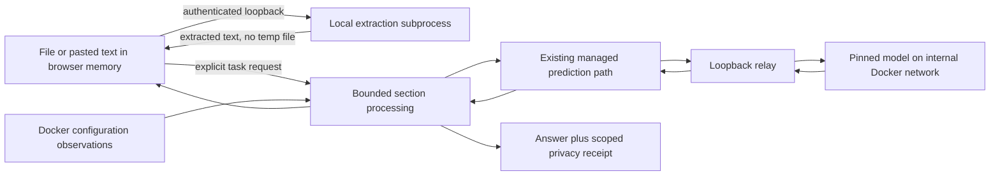

# Private documents — local product branch

Status: draft development, not the #18 installer walkthrough and not published.
The new default screen is `/`; existing Studio is intact at `/advanced`, with its model
workspace at `/model`. No accounts, billing, cloud inference or analytics are added.

## Data flow



### Supported inputs and bounds

PDF with selectable text, DOCX, UTF-8 TXT/Markdown, or pasted text. No OCR, `.doc`, macro
execution, external document links or remote parsers. Maximum upload 3 MB, PDF 40 pages,
and extracted text 128,000 UTF-8 bytes. Unsupported/complex/encrypted files fail explicitly;
they are not silently truncated.

Extraction uses pipes rather than temporary files. The separate parser has a 384 MiB
memory limit and 8-second CPU limit (Windows Job Object; Unix resource limits), with
a 12-second parent deadline. PDF decompression/work limits and hardened DOCX XML parsing
are additional defenses. These resource limits are **not** an OS sandbox for arbitrary
parser code. A parser vulnerability, host malware, browser extensions, swap or crash dumps
remain outside the model's Docker boundary.

### Tasks and long documents

Summarise, document questions, action items, dates, simplify, draft a reply, translate,
or chat. The browser resends only the most recent user/assistant pair for plain chat,
bounded to 600 UTF-8 bytes. Shortened context is labelled; full answers remain visible
in this tab. Document tasks do not reuse unrelated chat context. Clear or close the tab
to discard it. There is
no persistent conversation history or automatic answer export.

Inputs are split on UTF-8 character boundaries into at most 1,000-byte sections. This
conservative byte budget supports the configured 4,096-token context; it is not a token
counter or retrieval index. Section results are combined in bounded stages for summaries,
questions and extraction. Translation, rewriting, actions and dates join independently processed sections;
cross-section coherence can suffer. The response and UI disclose staging, section count
and actual request count. Request/time/depth limits stop runaway processing. A token-limit
ending or a model/configuration change cannot produce a completed answer/receipt.

Documents can contain prompt injections. The prompt treats them as data; that instruction
is not a guaranteed defense against misleading output. The model has no tools, document
write access or internet route supplied by this workflow. Check consequential answers.
This product is not medical, legal, financial or regulatory-compliance advice/certification.

## What the privacy receipt proves

Before and after each request, Furnace checks the exact managed launch, pinned endpoint
identity, model weights verification recorded before launch, pinned image and observed
Docker settings: only its internal network, non-root user, read-only root/bind mounts,
all capabilities dropped, no new privileges and no direct published model ports. Missing,
false or changed evidence blocks the request or discards the answer. A scripted adapter
receipt is explicitly labelled test-only, never real Docker proof.

The receipt reports observation time, launch/model IDs, revision and weight hash. Weights
were hashed before launch; the receipt does not pretend to rehash them on every answer.
This is configuration evidence, **not** proof that nothing left the entire computer or
continuous packet capture. The host, Docker daemon, browser and other programs can have
internet access. Downloading app/model files uses internet; answering uses the local path.

Application policy: document text and answers are not written to project records,
operation logs or project exports. Regression tests search actual records/logs and
decompressed exports for unique source/answer markers. That test coverage is not a runtime
DLP scanner and does not cover user copies, OS/browser caches or privileged attackers.

## Model candidate and evaluation

Default candidate: official Qwen2.5-1.5B-Instruct Q4_K_M, revision
`91cad51170dc346986eccefdc2dd33a9da36ead9`, weights SHA-256
`6a1a2eb6d15622bf3c96857206351ba97e1af16c30d7a74ee38970e434e9407e`.
The [official pinned model card](https://huggingface.co/Qwen/Qwen2.5-1.5B-Instruct-GGUF/blob/91cad51170dc346986eccefdc2dd33a9da36ead9/README.md)
declares Apache-2.0; the repository contains its license. Preserve its license/notices
when distributing weights. This is distinct from Qwen2.5-3B's license; no inference about
an entire model family is used. The 0.5B recipe remains the low-memory option.

The candidate completed installed-runtime trials on CPU with about 8 GB available to
Docker and on the owner's 4 GB NVIDIA GPU. See [actual results and failures](everyday-validation.md):
5/9 rule checks passed on each device, with two tasks unscored. The candidate is not
quality-approved. Older 0.5B/Granite records and scripted checks are separate evidence.
`everyday_suite.json` contains synthetic documents and fixed field/rule checks. Missing-
information and reply-quality tasks remain unscored for human review. Per-task latency,
failures, token-limit results and model identity belong in the actual run record; no
semantic quality score or speed guarantee is inferred from field presence.

## Verify locally

```powershell
uv sync --frozen
uv run pytest -q apps/api/tests/test_everyday.py
uv run playwright install chromium
uv run python scripts/verify_everyday.py
```

The browser harness runs real extraction and loopback requests through the scripted
test adapter, checks the receipt, clear, mobile layout and absence of external requests.
It does not run an LLM or demonstrate human comprehension. Windows CI keeps this separate
from installation/preflight/export/quit/uninstall checks. Installed-model receipts and an actual document recording now exist for source 2c250d6;
selected-release verification, model-quality review and publication approval remain gates.


## Manipulated document text

The model receives a separate system-role instruction and unique document delimiters.
Document text is untrusted data, including anything claiming to be a system prompt,
safety policy or assistant instruction. Intermediate section results remain untrusted.
A heuristic flags AI-directed phrases and shows a warning on the answer. It can miss
attacks or flag harmless quotations; absence of a warning is not a safety verdict.

This is partial mitigation, not prompt-injection resistance. The eight-case CPU baseline
passed 0/8, delimiters alone still passed 0/8, and separate system-role instructions
passed 2/8. Original outputs and intermediate failures are retained. The isolated model
has no internet route at the observed checks and no URL-fetching/tool-execution capability
provided by this workflow. A manipulated document can still distort an answer or cause
sensitive text to be repeated in the local answer. The host/browser, privileged Docker
access and user copies remain outside that model-container boundary.

Every real answer shows a one-line summary while receipt details stay collapsible.
Scripted-adapter responses remain explicitly test-only. The summary describes observed
configuration, not continuous network monitoring or whole-computer privacy proof.

## Larger text documents

The extracted-text limit is now 128,000 UTF-8 bytes; the 3 MB file and 40 PDF-page bounds
remain. Text PDFs only: scans and image-only sections still need OCR, which is not included.
Streaming progress reports completed model requests and section count. Remaining time is
a rough estimate based on this task's observed pace, not a promise; combining stages can
add requests. Processing has at most 512 requests/four reduction levels and a 30-minute
scheduling budget. A request already sent can run to its individual timeout. Disconnecting
stops scheduling further sections once the current request completes. Summaries may lose
cross-section context; extraction limits do not guarantee answer quality.
