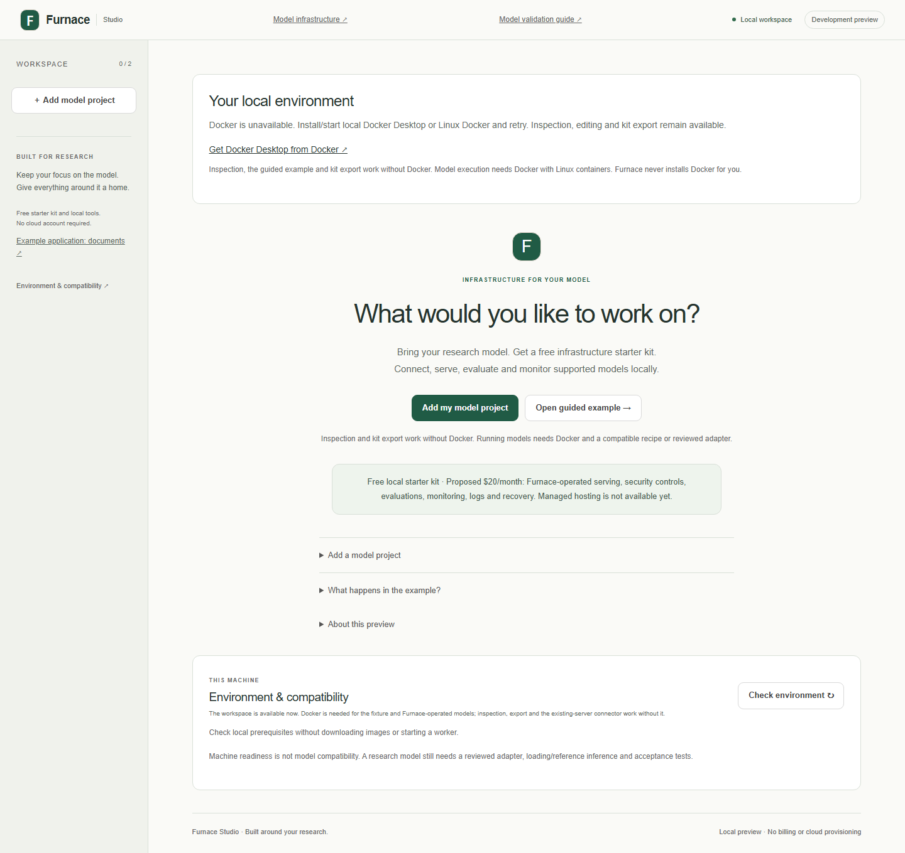

# Installed Studio preview: 9598d6d

**Provisional preview, not the December 4 final installer.** These records accept
the Studio journey only. Installed private-document acceptance is missing here.
The final source must be rebuilt once and both journeys accepted on that new binary's
exact bytes; these records must not be transferred to it.

Exact source: `9598d6d83beb25f7a372d6bf3f1299f4e9e7c5b3`.
SHA-256: `8fdb61c18526a811952edfe3f8aefb90735df22f6a69d2251aa4a7600fc9a02d`.
Size: 33,559,283 bytes. Unsigned, unpublished, version 0.1.0.
[Installer metadata](installer.json).

The actual CI-built installer was hash-checked and installed into a new QA directory
outside every checkout, after refusing existing Furnace registrations. Its bundled
interpreter (`-I`) ran both model journeys. The harness checked import ownership;
source/user-site code could not replace the installed application.
No existing registration was found. The raw install receipt's
`existing_installation_refused` field names the enabled guard; it does not mean a
conflicting existing installation was injected and a refusal exercised.

| Executed check | Result / record |
| --- | --- |
| Silent per-user install, installed identity and registration | [Passed](install.json) |
| Installed browser, actual UI ZIP export, quit and lease release | [Passed](installed-smoke.json); application child had Python/Git/uv removed from PATH |
| Qwen2.5-0.5B CPU operational lifecycle | [Passed](qwen-cpu.json); **11/12 quality rules**, 12/12 repeat/relaunch outputs identical |
| Granite 4.0 H 350M CPU operational lifecycle | [Passed](granite-cpu.json); **7/12 quality rules**, 12/12 repeat/relaunch outputs identical |
| Silent uninstall, QA runtime and registration removed | [Passed](uninstall.json); QA-owned export outside the app retained |

Both model journeys covered authenticated serving, inference, evaluation, monitoring,
a killed model during evaluation, explicit restart, a hard Studio crash, recovery
without automatic reconnection, evidence export and container cleanup. Wrong answers
remain. An operational pass is not a perfect quality score.

This screenshot is from the installed smoke check, not the API-driven model runs.
The real-model runs reused pinned cached weights/images and reverified weights. Their
relative cache path also exercised the previously fixed Docker mount defect.

This was the existing Windows account, **not** an independent consumer account.
SmartScreen, interactive install/uninstall choices and human comprehension remain
untested. No new GPU, arbitrary researcher architecture, public deployment, hosted
service or billing is claimed. The network check is one egress probe plus Docker
configuration, not host-wide monitoring or isolation from every host service. Docker
administrators can inspect running container environments.

Later documentation/verification commits do not relabel these bytes. A different
compiled candidate needs its own evidence. Historical failed runs remain unchanged.
