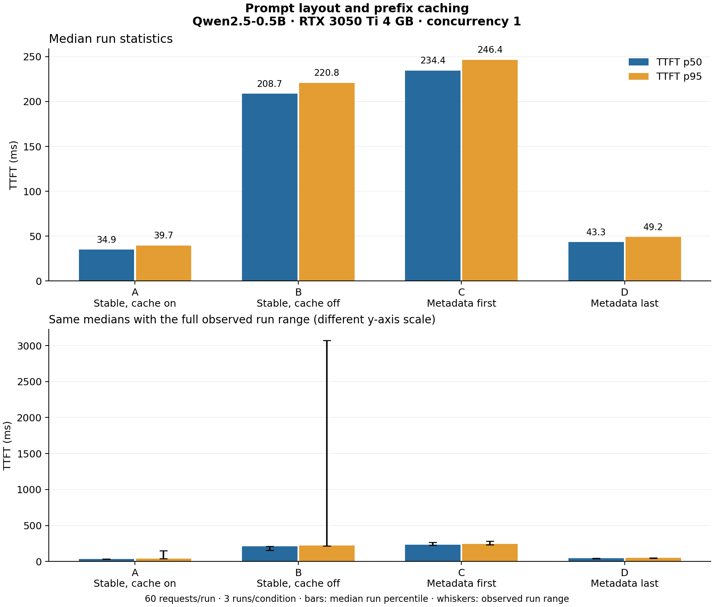

# Recorded results: prefix caching and prompt layout

Campaign: `2026-10-19-small-model-v2`. See [protocol](protocol.md) and [manifest](runs/2026-10-19-small-model-v2/manifest.json).

All four conditions completed three fresh-server runs with 60 successful measured requests per run (720 total). Warmups are excluded. Main values are medians of the three run-level statistics; requests are not treated as independent repeated experiments.

| Condition | TTFT p50 (ms) | TTFT p95 (ms) | Completion tok/s | Cache hit (metrics delta) |
|---|---:|---:|---:|---|
| A: Stable, cache on | 34.92 | 39.69 | 88.89 | 98.13% |
| B: Stable, cache off | 208.74 | 220.77 | 61.14 | N/A (disabled) |
| C: Metadata first | 234.45 | 246.39 | 56.61 | 0.00% |
| D: Metadata last | 43.27 | 49.20 | 86.27 | 94.00% |

## Every run

| Repeat | Condition | p50 ms | p95 ms | Completion tok/s | Cache hits / queries (delta) | Logged cache percentages | Evidence |
|---:|---|---:|---:|---:|---|---|---|
| 1 | A | 34.92 | 151.50 | 25.91 | 90240.0 / 91959.0 | 49.3%, 74%, 84.4%, 90.1%, 91.7%, 93.6%, 94.6%, 95.1%, 95.5%, 96.6%, 96.6% | [success](runs/2026-10-19-small-model-v2/r1-A-attempt1/summary.json) |
| 1 | B | 152.76 | 3072.90 | 25.28 | 0.0 / 0.0 | 0%, 0%, 0%, 0%, 0%, 0%, 0%, 0%, 0%, 0% | [success](runs/2026-10-19-small-model-v2/r1-B-attempt1/summary.json) |
| 1 | C | — | — | — | — | Failed: RuntimeError: server exited before readiness; see preserved server log | [failed](runs/2026-10-19-small-model-v2/r1-C-attempt1/summary.json) |
| 1 | C | 229.31 | 234.07 | 58.72 | 0.0 / 96082.0 | 0%, 0%, 0%, 0%, 0% | [success](runs/2026-10-19-small-model-v2/r1-C-attempt2/summary.json) |
| 1 | D | 40.54 | 45.61 | 90.19 | 90240.0 / 96022.0 | 70.9%, 87.8%, 91.9%, 92.5% | [success](runs/2026-10-19-small-model-v2/r1-D-attempt1/summary.json) |
| 2 | B | 208.74 | 214.05 | 61.43 | 0.0 / 0.0 | 0%, 0%, 0%, 0%, 0%, 0% | [success](runs/2026-10-19-small-model-v2/r2-B-attempt1/summary.json) |
| 2 | C | 234.45 | 246.39 | 56.61 | 0.0 / 96064.0 | 0%, 0%, 0%, 0%, 0%, 0% | [success](runs/2026-10-19-small-model-v2/r2-C-attempt1/summary.json) |
| 2 | D | 43.63 | 49.20 | 86.27 | 90240.0 / 96004.0 | 70.8%, 88.6%, 91.9%, 92.6% | [success](runs/2026-10-19-small-model-v2/r2-D-attempt1/summary.json) |
| 2 | A | 35.21 | 39.69 | 88.89 | 90240.0 / 91959.0 | 74%, 92.1%, 96%, 96.6% | [success](runs/2026-10-19-small-model-v2/r2-A-attempt1/summary.json) |
| 3 | C | 264.21 | 282.45 | 39.18 | 0.0 / 96046.0 | 0%, 0%, 0%, 0%, 0%, 0%, 0% | [success](runs/2026-10-19-small-model-v2/r3-C-attempt1/summary.json) |
| 3 | D | 43.27 | 52.88 | 82.20 | 90240.0 / 95986.0 | 70.9%, 84.8%, 91.6%, 92.6%, 92.6% | [success](runs/2026-10-19-small-model-v2/r3-D-attempt1/summary.json) |
| 3 | A | 34.08 | 37.84 | 91.13 | 90240.0 / 91959.0 | 74%, 92.1%, 96%, 96.6% | [success](runs/2026-10-19-small-model-v2/r3-A-attempt1/summary.json) |
| 3 | B | 209.74 | 220.77 | 61.14 | 0.0 / 0.0 | 0%, 0%, 0%, 0%, 0% | [success](runs/2026-10-19-small-model-v2/r3-B-attempt1/summary.json) |

## Metric definitions and scope

- TTFT: FurnaceBench streaming client, request send to the first chunk carrying generated output; empty/role-only chunks are excluded. Raw records retain first-byte latency separately.
- Completion tok/s: server-reported completion tokens divided by first measured send to last measured completion. Fixed 32-token outputs, ignore EOS. Stream chunks are not counted as tokens.
- Cache hit in the main table: sum of measured-window server counter hit deltas divided by query deltas. Warmup excluded after settling asynchronous counters. Server log percentages are listed separately above; their log windows can include warmup/idle time and are not averaged into a run rate.
- The chart's whiskers show observed run range, not confidence intervals. Stored FurnaceBench request-percentile bootstrap intervals are not used as across-run confidence estimates.
- Single laptop GPU, synthetic runbook and queries, one model, one concurrency, short fixed completions. This establishes no result for Qwen3-4B or production traffic.
